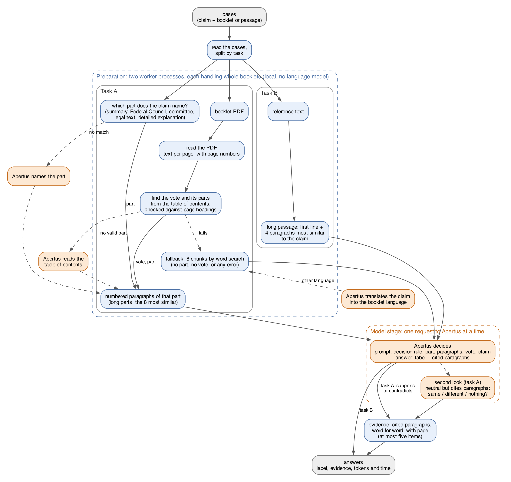
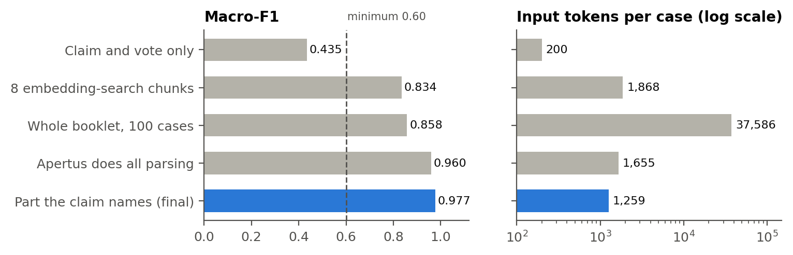
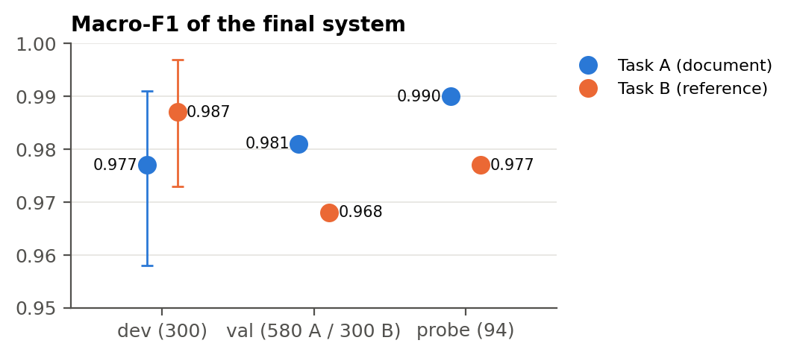
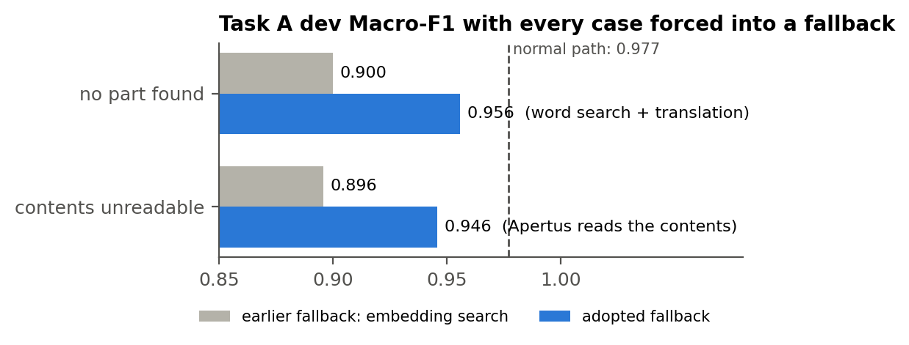
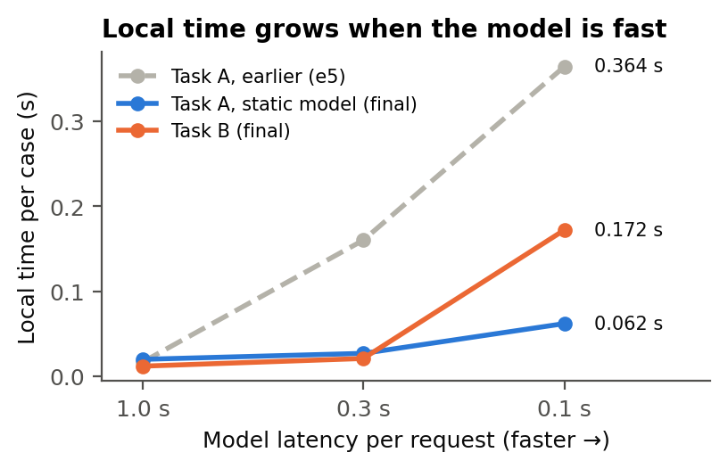

# Technical report — NLI over Swiss federal voting booklets with Apertus

Every number in this report comes from a recorded run (listed at the end), on our development split (dev), a
validation set (val) or a probe set of two unseen voting dates. **The sealed test dates have not been run.**

- **Track:** `Track 2A — OST: Multilingual Natural Language Inference over Swiss Official Voting Booklets`
- **Event:** Online
- **Project:** TODO project name
- **Team:** TODO team name — Rashad, Kaan (TODO full names)
- **Demo:** none

## 1. Summary

Before every federal vote, each Swiss voter receives a booklet explaining the proposal and the arguments for and
against it. Given a claim in German, French or Italian, our system decides whether the booklet **supports** it
(entailment), **does not settle** it (neutral) or **contradicts** it (contradiction). In task B the source is a
short passage; in task A it is the whole booklet PDF, and the system must find the passage itself and quote it with
its page number.

Apertus v1.5 (8B) makes every decision. Everything else runs locally on a CPU: reading the PDF, choosing what
Apertus reads, and turning the paragraphs it cites into evidence.

The challenge's central question is whether Apertus should read the whole booklet or a selected part. On 100 dev
cases, the whole booklet scored a Macro-F1 of 0.858 at 37,586 input tokens per case; only the part the claim refers
to scored 0.989 at 1,248 tokens; no booklet text at all scored 0.435. Our design follows from this: find the part a
claim is about and send only that.

| Final system | dev | val | probe |
|----------------------------|----------|----------|----------|
| Task A Macro-F1 | **0.977** | **0.981** | **0.990** |
| Task A evidence score | **0.990** | **0.988** | **1.000** |
| Task A tokens per case (input + output) | 1,259 + 14.9 | 1,233 + 14.9 | 1,177 + 16.6 |
| Task A local time per case, model at 1.0 / 0.3 s per request | 0.020 / 0.027 s | 0.010 / 0.010 s | 0.039 / 0.035 s |
| Task B Macro-F1 | **0.987** | **0.968** | **0.977** |
| Task B tokens per case (input + output) | 815 + 9.0 | 820 + 9.3 | 789 + 8.3 |
| Task B local time per case, 1.0 / 0.3 s per request | 0.012 / 0.021 s | 0.009 / 0.010 s | 0.020 / 0.019 s |
| Labels not set by Apertus (unreadable answer → neutral) | 0 of 600 | 1 of 1,160 | 0 of 188 |
| **Our estimate of the official score** at 1.0 / 0.3 s per request (section 6) | **0.904 / 0.893** | **0.908 / 0.907** | **0.901 / 0.902** |

All numbers come from the published Docker image (`sha-7ae78ad87cfd`).

**Sealed test dates** (2020-02-09, 2022-02-13, 2022-05-15): TODO, results after the organisers' evaluation.

## 2. Architecture

{width=70%}

*Figure 1. Blue: local work, no language model. Orange: a call to Apertus. Dashed arrows: taken only when the step
before fails.*

Each case has two stages: **preparation** (local: read the booklet, find the part, build the prompt) and the
**model call** (Apertus answers). Two worker processes prepare cases while the main process sends them to Apertus,
so most local work happens while we wait for the model, which is not counted as local time.

Every case gets an answer: if a step fails, the case takes a simpler fallback, and if Apertus's answer cannot be
read, the label is neutral. Apertus runs at temperature 0, so the same request gives the same answer.

## 3. How the booklet is prepared for the model

**Reading the PDF.** We extract each page's text with its page number, reading a page only when it is needed.

**Finding the right part (task A).** A booklet covers several votes, each with the same parts: summary, Federal
Council's arguments, committee's arguments, detailed explanation and legal text. Claims almost always name their
part ("Laut der Zusammenfassung …", "Le Conseil fédéral estime …"). We use this in five steps:

1. **Which part?** Patterns in German, French and Italian map the claim's opening to a part. If none matches,
   Apertus names the part.
2. **Where is it?** The table of contents gives where each vote and part starts; each start page is checked against
   its printed heading. If the contents cannot be read, Apertus reads them instead.
3. **Which vote?** The case's vote name is matched to the contents titles, or, failing that, to the title closest
   in meaning (local embedding model).
4. **What to send.** The part is split into numbered paragraphs, each with its page. Parts over 8,000 characters
   are cut to the 8 paragraphs most similar to the claim (a fast static embedding model).
5. **Fallback.** If no part or vote is found, we send the 8 chunks of the booklet that share the most words with
   the claim. If claim and booklet differ in language, Apertus first translates the claim for this search.

**Task B.** The passage is given. Passages over 3,000 characters are cut to their first line (which names the
ballot) and the 4 paragraphs most similar to the claim.

**What Apertus sees.** The prompt starts with a decision rule based on the challenge's label definitions:

> Decide in this order: 1. Does the reference text deal with the subject of the claim at all? If not, the label is
> 1 (neutral). 2. If it does: 0 if it supports the claim; 2 only if it states something that cannot be true together
> with the claim; otherwise 1. Missing information is never a contradiction. […]

Then follow the part's name (e.g. "the committee's arguments"), the numbered paragraphs, the vote and the claim.
Apertus answers in a fixed JSON format: a label and, in task A, up to three paragraph numbers it relied on.

**A second look.** When Apertus answers "neutral" but still cites paragraphs, it has often found the right place
but is unsure. We then show it only those paragraphs and their neighbours and ask whether they say the **same**,
something **different**, or **nothing** about the claim (entailment, contradiction, neutral).

**Evidence.** We return the paragraphs Apertus cited, word for word, with their page. An item counts if it lies
inside the gold passage or contains it, so we fill the five allowed items with the cited paragraphs' halves, the
paragraph before (when the cited one starts a page) and the whole cited page. Neutral answers and task B get no
evidence.

## 4. How Apertus is used

**Apertus makes every judgement; our code only decides what it reads** and never sets a label (except neutral for
an unreadable answer: once in 1,948 final answers). We use the 8B model zero-shot, without fine-tuning or examples.
Apertus has five roles; only the first is needed in every case:

::: {.compact}
| What Apertus does | When | Calls per 100 cases (A / B) | Tokens per call, in + out |
|----------------------------------|-----------------------------|-----------|------------------|
| **Decides the label** and names the paragraphs it rests on | every case | 100 / 100 | 1,251 + 14.6 (A); 815 + 9.0 (B) |
| Names the booklet part a claim refers to | our patterns do not recognise the claim's opening | 0 / – | ≈ 236 + 49 |
| Reads the booklet's table of contents | our parser cannot read it | 0 / – | ≈ 1,825 + 192 per booklet |
| Translates the claim into the booklet's language | the word-search fallback, across languages | 0.33 / – | 141 + 55 |
| Takes a second look at the cited paragraphs | the answer is neutral but cites paragraphs | 1.7 / – | 454 + 8 |
:::

**What Apertus reads matters most.** We compared the final system with four other ways of giving Apertus the
booklet, everything else unchanged. "Apertus does all the parsing" means it names the part and reads the contents in
every case, not only as a backup.

::: {.compact}
| What Apertus reads (task A, dev) | Macro-F1 | Evidence | Input tokens per case |
|------------------------------------------------|--------|--------|-------------------------|
| nothing: claim and vote only | 0.435 | — | ≈ 200 |
| 8 chunks found by embedding search | 0.834 | 0.662 | 1,868 |
| the whole booklet (100 cases) | 0.858 | — | 37,586 |
| Apertus does all the parsing | 0.960 | 0.891 | 1,655 |
| **the part the claim names (final)** | **0.977** | **0.990** | **1,259** |
:::

{width=90%}

*Figure 2. What Apertus reads in task A (dev): Macro-F1 (left) and input tokens per case (right, log scale). Blue:
the final system. Dashed: the minimum Macro-F1 for a valid submission (0.60).*

The whole booklet is the most expensive and not the most accurate: Apertus loses the passage among tens of
thousands of tokens. Apertus doing all the parsing is nearly as good but costs a third more tokens and eight times
the local time, so it is only a backup. We could not compare with the 70B model: the endpoint refused all our calls.

**Remaining errors** (val, an earlier version). Of 23 task A errors, 10 are **search errors** (the right passage was
not sent, mostly because a long part was cut) and 13 **reading errors** (negation or direction 6, scope 5, number or
date 2). All 18 task B errors are reading errors, most often a claim about another ballot (6) or a wrong number or
date (6).

**What we tried and did not keep.** We evaluated many variants against the system of the time, each changing one
thing, with the rule for keeping it fixed before the run:

::: {.compact}
| Variant | Result against the system of that time (Macro-F1, dev unless marked) | Why not kept |
|------------------------------------------|-------------------------------------|----------------|
| shorter prompts (A; B); three examples in the prompt (B) | 0.670; 0.667; 0.933 vs 0.947 | lower |
| only the 4 most similar paragraphs | dev 0.990 with 35 % fewer tokens; val 0.944 vs 0.959 | did not hold on val |
| claim split / several languages / separate negation check | A 0.963 / 0.980 / 0.987 vs 0.983; B 0.937 / 0.970 / 0.960 vs 0.967 | no clear gain for 1.7–3 calls per case |
| second look with the 3 most similar paragraphs | dev +0.010, val +0.003 | below the +0.015 we required |
| second look: "related but not settled" = "nothing" | the same answer in all 19 second looks | no change |
| five rewordings of the task A prompt | dev 0.902–0.983 vs 0.983; on-topic neutrals kept 13–28 of 46 vs 32 | lower, or broke correct neutrals |
| task B as numbered paragraphs; task B cut to 4 paragraphs by embedding | 0.963 vs 0.967; 55 % fewer tokens but slower | lower, or slower |
| other ways to shorten long task B passages | 0.973 / 0.993 (+13 % tokens) / 0.967 vs 0.987 | lower, or too many tokens |
| task B: ballots named first / title added / claim first | 0.892 (19 unreadable answers) / 0.980 / 0.980 vs 0.987 | lower or unreadable |
| task B: "is the claim about this ballot?" after a contradiction | 0.970 vs 0.987; 1 fixed, 6 broken; +7 % tokens | wrongly dismissed claims that misstate their ballot |
| code rule "neutral with a citation → contradiction" | val +0.014 offline; 3 of 3 on-topic neutrals wrong | the code may not set a label |
:::

## 5. Data

- **Dataset:** `OSTswiss/MNLIoverSwissVotingBooklets` v1.1 (MIT): 1,488 rows, of which 335 are exact duplicates.
  Each row gives one task A case and one task B case.
- **Splits** by voting date, duplicates removed: test 5 dates (267 rows), dev 300 rows, val 580 further rows of
  the dev dates (only for confirming). Two test dates (94 rows) were opened as an unseen **probe**; three stay sealed.
- **Booklets:** the Federal Chancellery's PDFs, not stored in the repository; for parser tests, all 93 federal
  booklets 2016–2026. Official reports are exempt from Swiss copyright (Art. 5 URG); no personal data.

## 6. Evaluation

**How we measured.** We use the organisers' evaluation script. The official score combines Macro-F1, evidence
(task A), tokens per case and **local time** per case (running time minus time waiting for the model), the last two
relative to the best team. Our estimate uses fixed reference values instead (600 / 800 tokens, 0.05 / 0.005 s for
task A / B). Because the endpoint's answers drifted between days, we only compared versions within one run, sending
each case to every version back to back.

{width=55%}

*Figure 3. Macro-F1 of the final system on dev, val and the probe (two unseen voting dates). Bars on dev: 95 %
bootstrap intervals. The axis starts at 0.95.*

**Stability.** Three runs of all 600 dev cases, 30 minutes apart, gave **identical labels**. The larger uncertainty
is the small sample: 95 % bootstrap intervals are [0.958, 0.991] (task A) and [0.973, 0.997] (task B), which covers
the differences between dev, val and probe.

**Other booklets.** On all 93 booklets from 2016–2026, 244 of 249 votes pass every parser check (178 before our
fixes).

**Fallbacks.** Since fallbacks are rare, we forced every case into one (Macro-F1 / evidence):

::: {.compact}
| Situation | dev | val | Tokens per case (dev) |
|---|---|---|---|
| normal: the part is found | 0.977 / 0.980 | — | 1,238 + 14.5 |
| no part found → word search, Apertus translates the claim | 0.956 / 0.736 | 0.957 / 0.755 | 2,591 + 44.3 |
| table of contents unreadable → Apertus reads it | 0.946 / 0.925 | 0.939 / 0.917 | 1,564 + 42.8 |
:::

{width=60%}

*Figure 4. Every dev case forced into a fallback: the earlier embedding search (grey) against the fallback we kept
(blue).*

**Task B.** Cutting long passages raised Macro-F1 (dev 0.967 → 0.987, val 0.954 → 0.968) and cut input tokens per
case from 1,994 to 815.

**Local time** (2 CPUs, 4 GB, a fake model answering after a fixed delay). The faster the model, the less local
work hides behind it. Our first ranking model (multilingual-e5-small) took about 3 s per long part; the static model
takes milliseconds:

::: {.compact}
| Local time per case, dev | model at 1.0 s per request | 0.3 s | 0.1 s |
|---|---|---|---|
| Task A, final (static embedding model) | 0.020 s | 0.027 s | 0.062 s |
| Task A, earlier version (e5) | 0.017 s | 0.160 s | 0.364 s |
| Task B, final | 0.012 s | 0.021 s | 0.172 s |
:::

{width=50%}

*Figure 5. Local time per case (dev) as the model gets faster. With e5, the ranking no longer hides behind the model;
with the static model it does.*

**Memory.** Task A needs 0.2–0.4 GB, task B 1.2–1.7 GB; every case is answered down to 512 MB.

**Unseen booklets.** On the probe, task A scores 0.990 (evidence 1.000) and task B 0.977. 90 of 94 task A cases are
routed; the other 4 concern a committee that the vote does not have and go to the fallback.

**Qualitative examples.** TODO: a few typical cases (one correct entailment, one contradiction, one neutral, one
error) and one full worked example from claim to prompt to answer and evidence.

## 7. Limitations

- **Tuned on dev.** Prompts and rules were written looking at dev; val and the unseen probe confirm the scores.
- **Booklet layout.** Part-finding relies on the booklet structure used since 2016; anything else goes to the less
  accurate fallback.
- **Only the 8B model.** Everything was built on the 8B; we do not know which model the organisers will use.
- **Speed.** With a much faster model, PDF reading would no longer hide behind the model calls.
- **The second look** can turn an on-topic passage that does not settle the claim into a contradiction (2–3 of 46
  such cases). We kept it because on val and probe it fixed 18 answers and broke 2.
- **Task B, other ballots.** 8 of 19 final val errors are passages about another ballot called a contradiction;
  three attempts to fix this cost more than they gained.
- **Evidence pages.** Gold passages often start on the page before the one we cite; if the official check uses the
  first page, about 40 % of our hits would not count.
- **Not political advice.** The system only checks claims against the booklet's text. Its answers are not voting
  recommendations; every task A "supports" or "contradicts" comes with the page and exact text it rests on.

## 8. Reproducibility

- **Image:** `ghcr.io/rashad18236/hackapertus-voting-nli:latest`, built from `main`, run with the organisers'
  command (README); final numbers from `sha-7ae78ad87cfd`. **From source:** `make run`.
- **Hardware:** CPU only; measured with 2 CPUs and 4 GB. **Determinism:** temperature 0; replaying saved answers
  reproduces every label and evidence item.
- **License:** code Apache-2.0; report text CC-BY-4.0.

## References

- Dataset: OSTswiss/MNLIoverSwissVotingBooklets v1.1, Hugging Face (MIT). Starter:
  `gitlab.com/ifsoftware/hackapertus-starter`. Apertus v1.5, Swiss AI Initiative.
- Wang, L. et al. (2024). *Multilingual E5 Text Embeddings.* arXiv:2402.05672 (MIT). Static embedding model:
  `sentence-transformers/static-similarity-mrl-multilingual-v1` (Apache-2.0). Robertson, S., Zaragoza, H. (2009).
  *The Probabilistic Relevance Framework: BM25 and Beyond* (the word search of the fallback).
- Runs behind the numbers (folders in `docs/runs/`, 8 to 15 October 2026): final system `final-s15_*`; stability
  `stability-s15-run{1,2,3}_dev600`; memory `memory-grid-final-s15_grid24`, `memory-guard_grid48`; task B shortening
  `taskb-selectors_*`; parser coverage `parser-coverage_booklets93`; fallbacks `fallbacks_*`,
  `S-and-fallbacks_devA300`, `bm25ap-fallback_valA300`, `ap-structure-ask_*`; whole booklet `context-curve_devA100`;
  no booklet text `closed-book_devA300`; embedding chunks `section-route-vs-embed_devA300`; Apertus does all parsing
  `ap-all_devA300`; variants not kept `prompts-A_*`, `prompts-B_*`, `A6b_*`, `B1f_devB300`, `B6_devB300`; 70B
  `70B-smoke_devA3-devB3`.
